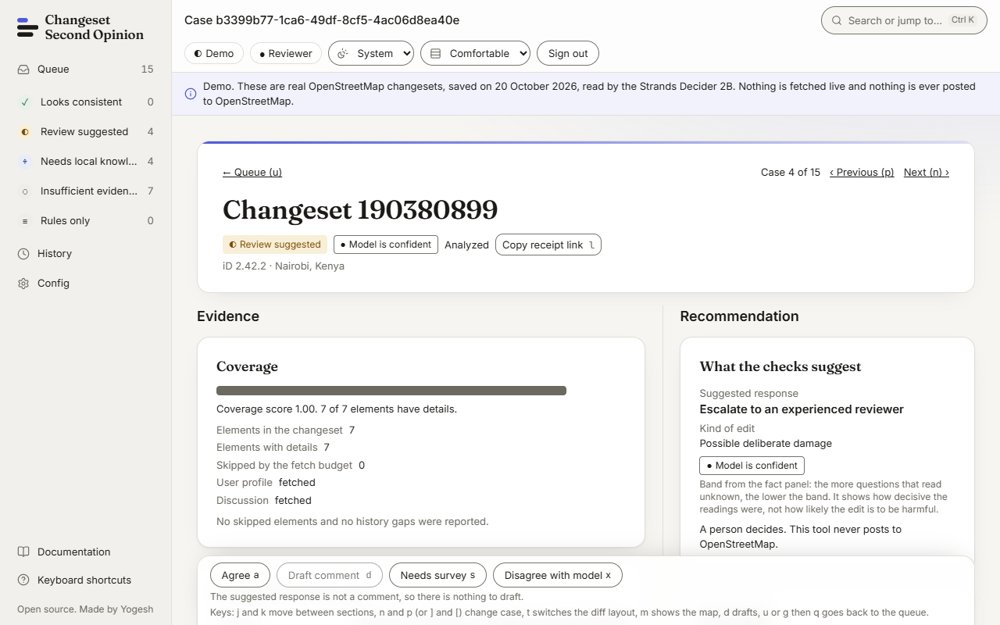
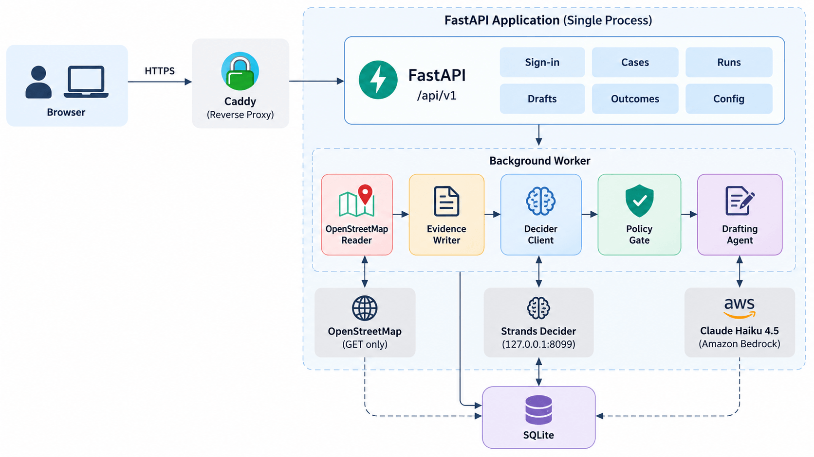
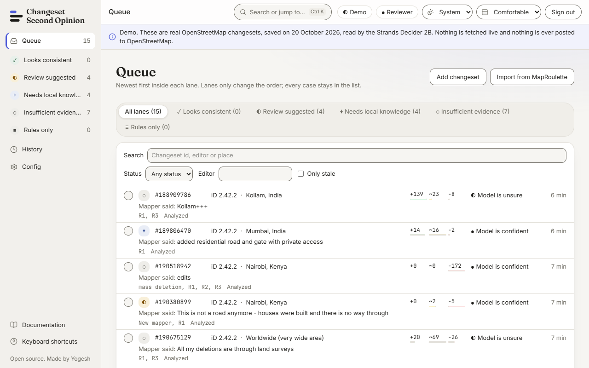
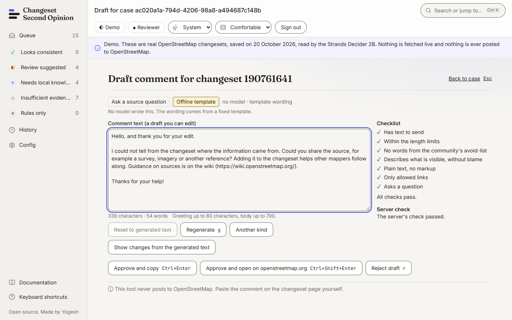
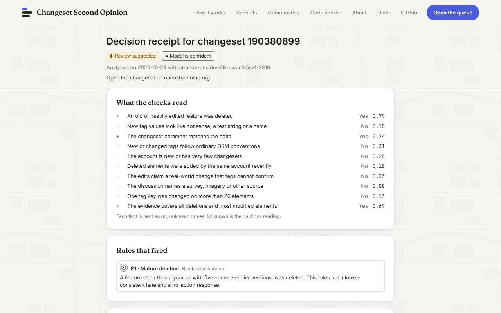

<div align="center">


# Changeset Second Opinion

**A second opinion on flagged OpenStreetMap edits. Evidence first; a person decides and posts.**

[Live demo](https://osm.changesetreview.online) · [Docs](https://osm.changesetreview.online/docs/) · [Run it in 5 minutes](#run-it-in-5-minutes)

[](https://github.com/yogeshselvarajan/changeset-second-opinion/actions/workflows/ci.yml)
[](LICENSE)
[](https://github.com/yogeshselvarajan/changeset-second-opinion/commits/main)
[](https://github.com/yogeshselvarajan/changeset-second-opinion/stargazers)

<!-- PyPI badge: add this only after a package name is published.
[](https://pypi.org/project/PACKAGE-NAME/)
-->

</div>

<picture>
  <source media="(prefers-color-scheme: dark)" srcset="assets/screen-case-dark.png">
  
</picture>

A case on the recorded demo data, with a real reading from the Strands Decider 2B.

## What it does

When a changeset gets flagged by OSMCha, by a MapRoulette challenge or by a validator's hunch, someone has to look at it, usually with twenty more waiting. I built this to do the gathering so the reviewer can spend the ten minutes on judging.

For each flagged changeset it:

- collects the public evidence into one screen: the tag changes, the account, the discussion, and a record of what it could not fetch
- asks the Strands Decider 2B ten yes/no questions about that evidence and shows every probability, with a band from the backend
- orders the queue into lanes, so the cases that need a person soonest come first
- drafts a kind comment with Claude Haiku 4.5 on Amazon Bedrock when you ask for one, which you edit and post yourself
- keeps a public receipt for each analysis, so anyone can see which answers and rules led to the lane

## What it does not do

- It does not write to OpenStreetMap. A draft ends in a copy button and a link to the changeset.
- It does not hide cases. Every lane is visible and counted.
- It does not close, revert or post anything on its own.
- It does not give a single "% bad" score. You get all the option probabilities.
- It is not a verdict. It is a hackathon MVP, and the [limits](#how-well-does-it-work) are part of the README.

If you like it, a star on the repo helps other OpenStreetMap reviewers find it. If it saves you or your community real time, you can [sponsor the work on GitHub](https://github.com/sponsors/yogeshselvarajan).

## Try it without installing

The hosted demo at <https://osm.changesetreview.online> is replay only. It serves 15 real changesets recorded in October 2026, each with a real reading from the Decider. You can browse the queue, open a case and read a receipt. You cannot sign in, analyse a new changeset or draft a comment there. Those work when you run it yourself.

## Run it in 5 minutes

You need Docker with Compose v2. This starts the replay demo with no model, no AWS account and no `.env` file. From the repository root:

```sh
docker compose -f infra/compose/docker-compose.yml -f infra/compose/docker-compose.demo.yml up --build
```

The first build takes several minutes, because it also builds the docs site. When it is up, open <http://127.0.0.1:8080>. The queue lists 15 cases and the docs are at `/docs/`.

To sign in, make an invite code from a second terminal:

```sh
docker compose -f infra/compose/docker-compose.yml -f infra/compose/docker-compose.demo.yml exec api cso auth create-invite --role admin --max-uses 1 --ttl-hours 24 --label first-admin
```

The code prints once. To remove everything, including the data volume, run the same compose command with `down -v`.

Replay mode has no Decider, so analysing new changesets and drafting need a live install: the Decider (about 5 GB of weights), a real `CSO_USER_AGENT`, and optionally Bedrock. The steps are in the [Docker Compose guide](site/src/content/docs/self-host/docker-compose.mdx) and [Run the Decider](site/src/content/docs/self-host/run-the-decider.mdx). Without Docker, the [quickstart](site/src/content/docs/start/quickstart.mdx) uses `uv` and Node.

## How it works



The worker reads OpenStreetMap with a call budget of 50 per changeset and writes down what it could not fetch. "Insufficient evidence" is a normal result. The Decider answers ten fixed questions, such as whether a feature older than a year was deleted or whether the comment matches the changes. A policy gate then reads parsed facts (counts, ages, coverage) and the answers, and picks the lane and a suggested response. Drafting goes through one Strands tool, and a hook cancels the call unless the stored decision allows that kind of response. Why it is built this way: [How a verdict is made](site/src/content/docs/concepts/how-a-verdict-is-made.mdx) and [Architecture](site/src/content/docs/concepts/architecture.mdx).

<table>
  <tr>
    <td width="50%">
      <picture>
        <source media="(prefers-color-scheme: dark)" srcset="assets/screen-queue-dark.png">
        
      </picture>
      <sub>The queue, ordered by lane.</sub>
    </td>
    <td width="50%">
      <picture>
        <source media="(prefers-color-scheme: dark)" srcset="assets/screen-draft-dark.png">
        
      </picture>
      <sub>A draft the reviewer edits and posts.</sub>
    </td>
  </tr>
  <tr>
    <td colspan="2" align="center">
      <picture>
        <source media="(prefers-color-scheme: dark)" srcset="assets/screen-receipt-dark.png">
        
      </picture>
      <br><sub>A receipt: every answer, the rules that fired, the coverage.</sub>
    </td>
  </tr>
</table>

## Safety rules

CI checks the first three. They are not up for discussion in a pull request.

1. The code never writes to OpenStreetMap. The HTTP client does GET only, to `api.openstreetmap.org` and `maproulette.org`, plus one POST to the OpenStreetMap token endpoint for sign-in with the read-only `read_prefs` scope.
2. Nothing is hidden from reviewers. Lanes order the queue. There is no auto-close and no auto-post.
3. A model answer can only make a lane more cautious. The rules read parsed evidence, never a model answer.
4. Evidence text is untrusted. It is sanitised before it is shown, and URLs found in evidence are never fetched.

## How well does it work

Not proven yet, and I would rather say so here. The only evaluation is a 60 item development set whose labels were written by an AI, not by people. On it, the questions that read a number off the evidence (feature age, account age, mass retag) were near perfect. The questions that need judgement were weak, and the composed four-way guess at the edit's nature scored 0.38 accuracy, below the 0.50 of always answering the most common class. That is why rule hits stay authoritative and the nature guess is advisory. The held-out set is not blind, no live Bedrock result is recorded, and nobody has labelled the data by hand. The full list is in [What it cannot do](site/src/content/docs/concepts/what-it-cannot-do.mdx) and in [`evaluation/results/spike-2026-10-17.md`](evaluation/results/spike-2026-10-17.md).

## Deploy options

| Option | What runs | About per month |
| --- | --- | --- |
| Your laptop | Docker Compose, replay or live | Nothing for hosting. Bedrock drafts are billed per use. |
| One small instance | The replay demo on a `t4g.small` with Caddy, API and worker, from a CloudFormation template | 18 US dollars (estimate, not a measured bill) |
| Serverless demo | The replay demo on Lambda, CloudFront and S3, scales to zero | Well under 1 US dollar (estimate) |

The full product with a Decider on a GPU is a different size. A small community pays about 66 US dollars a month in total with the GPU awake 60 hours. The GPU alone costs about 590 a month if it stays on. Prices were read on 20 October 2026; the details and what was not checked are in [Deployment options](site/src/content/docs/self-host/deployment-options.mdx).

## Tech stack

Python 3.13 and FastAPI for the API and a durable job worker. SQLite for storage. React and Vite for the web app. Caddy at the edge. The Strands Decider 2B (`StrandsAgents/strands-decider-2B-qwen3.5-v1-2610`) answers the questions, served on `127.0.0.1` only. Claude Haiku 4.5 on Amazon Bedrock writes drafts through a Strands agent with one gated tool, and it is off unless you turn it on.

## Docs map

Everything is at <https://osm.changesetreview.online/docs/>, and the source is in [`site/`](site).

| If you want to | Read |
| --- | --- |
| Understand the tool | [What it is](site/src/content/docs/start/what-it-is.mdx), [How a verdict is made](site/src/content/docs/concepts/how-a-verdict-is-made.mdx), [Responsible use](site/src/content/docs/concepts/responsible-use.mdx) |
| Review cases | [First changeset](site/src/content/docs/review/first-changeset.mdx), [Work the queue](site/src/content/docs/review/work-the-queue.mdx) |
| Host it | [Docker Compose](site/src/content/docs/self-host/docker-compose.mdx), [Deploy on AWS](site/src/content/docs/self-host/deploy-on-aws.mdx), [Connect Bedrock](site/src/content/docs/self-host/connect-bedrock.mdx) |
| Adapt it to a community | [Tune to your community](site/src/content/docs/administer/tune-to-your-community.mdx), [`patterns/calibrated_action_gate/`](patterns/calibrated_action_gate/README.md) |
| Change the code | [Dev setup](site/src/content/docs/contribute/dev-setup.mdx), [Repo tour](site/src/content/docs/contribute/repo-tour.mdx), [Tests](site/src/content/docs/contribute/tests.mdx) |

## Contributing

Issues and pull requests are welcome. Read [`CONTRIBUTING.md`](CONTRIBUTING.md) first. It is a volunteer project run by one developer, so replies can take a few days ([`SUPPORT.md`](SUPPORT.md)). If you review OpenStreetMap changesets, telling me what the lanes or the draft got wrong is as useful as code.

## Security

Report problems privately, following [`SECURITY.md`](SECURITY.md). Do not open a public issue for a security problem.

## Independence

Changeset Second Opinion is an independent open source tool for OpenStreetMap reviewers. It is not endorsed by, sponsored by or affiliated with the OpenStreetMap Foundation. OpenStreetMap is a trademark of the OpenStreetMap Foundation, used under its trademark policy.

## Licence

Code is Apache-2.0 ([`LICENSE`](LICENSE)); third-party components are in [`THIRD_PARTY_NOTICES.md`](THIRD_PARTY_NOTICES.md). OpenStreetMap data and anything derived from it are © OpenStreetMap contributors under the [Open Database License](https://opendatacommons.org/licenses/odbl/). The Decider weights are downloaded at run time under their own licence, and Bedrock models fall under AWS service terms. No GPL or AGPL package is in the runtime dependencies; `psycopg` is LGPL and used unmodified.

## How this was built, and thanks

I am Yogesh Selvarajan ([LinkedIn](https://www.linkedin.com/in/yogesh-selvarajan/), [AWS Builder Center](https://builder.aws.com/community/@yogeshs)), and I built this for the AWS Agent Experience Hackathon: Strands Decider. Most of the code, tests and docs were written by AI agents (Claude Code) while I set the scope and approved each step. Automated checks gate every change, and nobody has done an independent review yet.

Thanks to the Strands Agents team for the Decider, to the AWS User Group Madurai for the kit, and to the OpenStreetMap contributors whose data and care this tool is meant to support.
